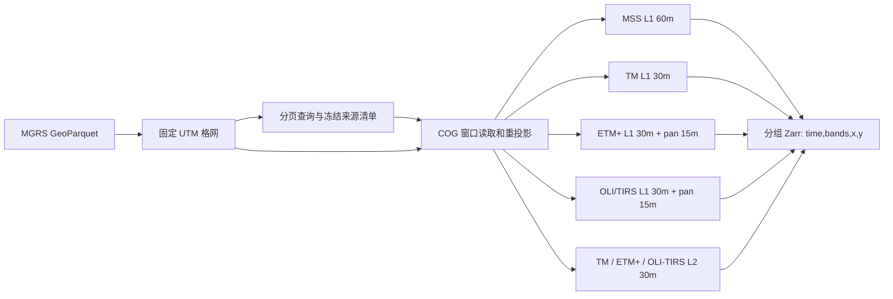

# 存储合同与扩展边界

## 先固定格网，再查询场景

输入的 MGRS GeoParquet 是空间真值来源。每个 product 的 grid 在查询前固定，
manifest 保存 SHA-256 和完整空间合同，所有景通过该合同重投影。
这避免影像覆盖变化导致数组大小、原点或像元位置随时间漂移。
使用完整源 polygon 投影后的 bbox，与 S1-GRiTS 相同；不在 bbox 内额外做 polygon 掩膜。

## 处理级别与数值语义

L1 已完成基础辐射和几何处理，光谱资产交付为整数 DN，逐景标定参数保存在 MTL。
L2 由 L1 生成大气校正后的地表反射率（SR），条件满足时提供地表温度（ST）。
L2 不提供全部 L1 通道，SR/ST 的 30 m 交付间距也不代表提高了传感器分辨率；
云和云影仍需使用 QA 筛选。定义见 [USGS L1](https://www.usgs.gov/landsat-missions/landsat-collection-2-level-1-data)
和 [USGS L2](https://www.usgs.gov/landsat-missions/landsat-collection-2-level-2-science-products)。

主档案按传感器族与处理级别分库，保留各自波段范围与物理含义；
不会将 L1 的 `red` DN 与 L2 的 `red` SR 编码值接在同一数组中。
两种级别写入时均保留源产品整数值。读取 L2 时先应用 `valid`，再用
`data * scale + offset` 得到物理量；L1 的恒等 scale/offset 不能代替 MTL 标定。
`open_group` 提供原值，公共反射率接口显式完成 L2 掩膜和缩放。
MSS 没有官方 Collection 2 L2 产品，因此不进入公共 SR 视图。

## 波段选择的三种方案

| 方案 | 优点 | 代价 | 本版选择 |
|---|---|---|---|
| 传感器／产品分组 | 保存独有波段和正确物理级别；无大量空 band | 跨传感器需要显式读取接口 | 主档案 |
| 全波段并集 | 单数组 band 坐标统一 | 大量结构性缺失；同名不等于同响应；L1/L2易混淆 | 可作为未来派生格式 |
| 仅公共波段 | L2 模型输入方便 | 丢失 coastal 等独有信息；无法纳入 MSS SR | L2 派生读取视图 |

MSS 的 `nir08` 与现代传感器的同名通道不能据此视为等效，
MSS 也不存在 TM/OLI 同等的 blue/SWIR 组合。
因此没有提供把 1972 至今直接当作统一地表反射率的函数。

## 一个产品库的合同

每个 group 有：

- `data(time,bands,x,y)`：原始产品整数值，无损压缩。
- `valid(time,bands,x,y)`：各资产的源像元／nodata 有效性；不代表云质量。
- `present(time,bands)`：源目录是否提供该资产。
- `time(time)`、`scene_id(time)`、`platform(time)`。
- `bands(bands)`、`x(x)`、`y(y)`、`spatial_ref`。
- `scale(time,bands)`、`offset(time,bands)`：L2 描述物理转换；所有 L1 用 DN 恒等系数，
  真实标定系数保留在 MTL 中。
- `source_band(time,bands)`、`source_dtype(time,bands)`。

各变量的有效范围独立。影像覆盖以测量波段的 `valid` 判断；
QA_RADSAT 的 0 可以有效，不能单独作为有影像或无云的依据。

root contract hash 绑定 schema、product、格网源 SHA、空间坐标、band 定义、
chunk 和重采样方式。不把源表路径绑定到 hash，以允许同一表的路径迁移。
来源 sidecar 记录原 STAC、MTL、实际源栅格 CRS、transform、shape、dtype、
nodata 和 tags；只保存未签名 URL。

现代 L1 使用 schema 2，把每个 group 的格网单独绑定到合同。
pan 在 15 m 下独立从同一个 MGRS polygon 外扩对齐，其他组使用发布的 30 m；
并不将 30 m 的宽高简单翻倍。旧 MSS/L2 保持原 schema 1 和原 hash，不迁移旧库。

`data` 分组并非“每个 band 一个变量”。每组都是用户要求的四维数组，
不同物理量／类型用 group 隔开；不能为了单数组而把 int16 辅助数据或
uint16 位编码无条件转换为 float16。

## 提交顺序

1. 独占该 product 库的文件锁，核验合同与已提交长度。
2. 验证提交记录及全部数组长度后，回滚最多一景未提交尾部；已提交数据较短、
   多景超长或记录无效则报错，不猜测修复。
3. 同场景身份和同来源指纹可跳过。来源变更报错，历史插入报错。
4. 核对实际仪器应采集的全部 L1 光谱资产，再让所有 group 增长一景并逐窗口写入。
   合法 OLI-only/TIRS-only 或 L2SR 中未采集／未生产的资产保持 `present=false`，
   必需资产缺失不能以填空冒充成功。
5. 再次检查本景读取的本地源文件状态，写入去除临时凭据的来源元数据，
   最后原子替换 commit ledger。

所有时间 chunk 长度为 1，回滚最后一个未提交时刻不共享前一景的数据块。
不同分辨率的组仍共用同一个场景 commit，pan 失败会回滚该景所有组。
初始化通过临时目录重命名发布完整 schema，异常初始化目录会保留供检查；
不会自动删除未知目录。

恢复检查同时核对数组类型、填充值、完整像元 chunks、CRS、Affine、波段定义和
时间单位。单景提交记录丢失仍可能与一次合法崩溃尾部无法区分，提交记录必须与
Zarr 数据一同保存；这些检查不是磁盘损坏后的内容修复机制。

窗口写入复用每个波段的 data/valid 数组句柄，场景元数据按组整行写入，
减少同一个 chunk 的重复打开与压缩。格式和旧库合同不变。
规划清单中的 chunk 上限仅计算 data/valid，不含坐标和 sidecar；
详细计数、基准及限制见 [实现审计](AUDIT_20261021.md)。

当前合同适用于单机本地文件系统，不能直接把 rename 或 file lock 的保证
推到 S3/object storage。多产品之间不做分布式原子事务；失败重跑各自续传。
进程中断恢复不等于在任意磁盘／文件系统损坏后都能恢复数据。

## 数据源与下一层产品

现代 L1 已接入 USGS 免费 STAC 发现、已下载文件导入与显式 AWS requester-pays
像元访问。运行时选择 local/aws 后端，持久化的原始 item 仍保留 USGS 来源身份。
AWS 凭证只走 SDK 标准链，不能写入 YAML、manifest 或 provenance。
MSS 和可选现代 L2 沿用 PC；L1 值不写入现有 `*-l2` 库。
L1/L2 数据本身都免费，云端平台可能产生访问费用，具体见
[USGS 费用说明](https://www.usgs.gov/faqs/when-do-i-need-amazon-web-services-aws-account-access-landsat-data-cloud-there-a-cost)。
现代 L1 免费下载需要通过 USGS 登录后取得产品，再按当前本地模式导入；
仓库尚未实现 EarthExplorer／M2M 登录下载。免费目录检索成功不代表像元可匿名读取。
本地源目录的索引只在一次作业内复用，输出目录必须独立于源目录。
读取边界、提交前和作业结束分别校验相关文件／目录状态；源树应保持只读。
PC 签名在打开资产前检查有效期，最多缓存 256 项临时签名；不缓存栅格像元，
也不承诺一次超长读取中签名过期后能无缝续读。失败仍按场景回滚并重跑。
若后续做 TOA、统一 30 m 并集、云掩膜、月合成或光谱响应校正，应生成具备
独立 provenance 的派生产品，而不是改变现有原始值的解释。

17MPU 全格网试点选择 PC 的 MSS L1、TM L2、ETM+ L2、OLI/TIRS L2 各一景。
它检验相应产品的完整 MGRS extent 写入与读取，不代表全历史覆盖，
也不能证明现代 L1 全色、卷云、ETM+ 双增益热红外或原生 B11 的真实下载能力。
四景已通过完整块扫描、源像元抽样和重复导入检查；实际覆盖率与公共反射率读取结果见 [17MPU 验收报告](VALIDATION_17MPU_20261021.md)。

## 可视化读取

本地 GUI 根据实际归档生成传感器、产品、变量组、波段和时间目录，读取每组自身的空间元数据。预览从 `(x,y)` 转置为图像的 `(y,x)`，经过有界降采样与 EPSG:3857 重投影后显示。L2 在有效掩膜内使用逐景比例系数，L1 保持 DN，QA 保持整数编码；颜色拉伸不改变源数组。MSS 的假彩色不补造蓝光通道。

GUI 使用归档文件锁并检查已提交时间长度，不读取未提交尾部。页面及预览服务仅绑定本机，原始数据保持原位。下载窗口的实际栅格范围与完整 MGRS 多边形分别展示，避免将窗口测试混作完整格网覆盖。实现与使用边界见 [GUI 使用说明](GUI.md)。

## 轨道选择与空间精度

参考 GRiTS-Resolver 的逐轨读取方案，Landsat 从已提交 STAC provenance 建立只读场景索引，以 `WRS1/Pxxx` 或 `WRS2/Pxxx` 区分轨道，Row 保留为沿轨景框。`open_scene` 要求唯一场景，`open_track` 保留该轨道各景时间与掩膜，不自动拼接。公共反射率视图遇到已知多轨道时要求显式选择或明确允许多轨道。既有像元数组无需迁移；详见 [光学轨道读取](OPTICAL_TRACKS.md)。

新建库将 `warp_tolerance=1e-9` 源像元绑定到合同，降低跨 UTM 变换近似导致的最近邻选点差异；逐波段来源也保存该参数。旧库合同无此字段时继续使用其历史 0.125 容限，避免同一库续写时悄然改变策略。参数是坐标变换误差容限，不是影像定位精度或传感器分辨率。
